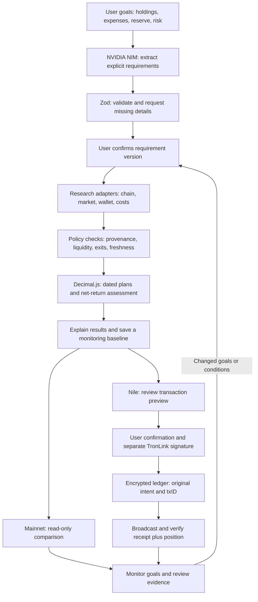

# TROMM

### Cash-flow-aware AI agent for TRON asset planning

[한국어](README_KO.md) · [Demo guide](docs/DEMO.md) · [Implementation status](docs/IMPLEMENTATION_STATUS.md)

TROMM is a web prototype built for **GWDC 2026 · TRON Challenge B**. It turns a user's holdings, dated expenses, reserve, and risk preferences into structured requirements, evaluates available plans, and monitors saved goals.

The central question is: **How much can I deploy while keeping funds available for planned expenses?** The language model handles requirement extraction; explicit rules and decimal arithmetic handle financial calculations and transaction checks.

**Current scope:** Mainnet market research and scenario comparisons, plus a separate, user-approved Nile testnet transaction workflow. Mainnet execution is disabled. The USDT demo uses an assumed 5% APY; it is not a measured product return.

## Contents

- [Results and verification](#results-and-verification)
- [Pipeline](#pipeline)
- [Agent design](#agent-design)
- [Application](#application)
- [Architecture](#architecture)
- [Quick start](#quick-start)
- [Limitations](#limitations)
- [Contributors](#contributors)
- [Documentation and references](#documentation-and-references)

## Results and verification

This table describes the checked-in implementation and its verification boundaries. Test files document automated coverage; historical on-chain success requires its own transaction evidence.

| Area | Implemented behavior | Verification boundary |
| --- | --- | --- |
| Requirement intake | NIM extraction, schema validation, follow-up questions, and reconfirmation after edits | Includes a template fallback; live model access requires a configured key |
| Expense-aware planning | Protects scheduled expenses and reserves; evaluates dated allocations when the required evidence is available | Missing costs, exit conditions, or fresh data prevent a verified net-return conclusion |
| Mainnet research | JustLend market reads and separate PSM, Stake 2.0, and SUN.io diagnostics | A successful read does not establish an executable investment route |
| Goal monitoring | Reassesses saved plans on open, every five minutes, and on focus | Produces maintain, pause-new-deposit, or review signals while the browser is running |
| Nile jTRX workflow | Deposit/redemption previews, separate wallet signatures, encrypted transaction tracking, and receipt/position checks | Historical live-test claims lack the original evidence files in this checkout |
| Nile PSM workflow | Bidirectional previews, approvals, balance/capacity/fee checks, and transaction tracking | Successful live round-trip evidence is not included |
| Record review and replay | Reviews transaction evidence and replays exported sessions | Missing evidence leaves realized profit/loss unresolved; replay sends no transactions |

See [implementation status](docs/IMPLEMENTATION_STATUS.md) for source modules, test coverage, and the distinction between implemented code and transaction evidence.

## Pipeline



The two chain environments keep separate balances, quotes, and transaction evidence. See [operations](docs/OPERATIONS.md) for the detailed approval and recovery sequence.

## Agent design

| Responsibility | Approach |
| --- | --- |
| Understand the request | NVIDIA NIM `openai/gpt-oss-20b` extracts explicitly stated facts; a template parser is available as a fallback |
| Resolve missing information | Zod validates inputs; the conversation asks for missing facts and requires confirmation of changed requirements |
| Gather evidence | Server adapters query market, contract, wallet, fee, and liquidity sources with provenance |
| Evaluate plans | Deterministic rules check eligibility; Decimal.js calculates returns and costs when evidence is complete |
| Follow the goal | Saved baselines drive monitoring signals and adjustment drafts |
| Support an approved action | Nile actions pass through preview, wallet ownership verification, separate transaction signing, and original-txID reconciliation |

The agent can return **hold**, **review**, or **insufficient data**. It does not need to produce a deposit recommendation for every request.

## Application

| Route | Purpose |
| --- | --- |
| `/` · `/nile` | Nile TRX/jTRX planning and a separate PSM technical test |
| `/usdt-demo` | Expense calendar, deployable amount, and illustrative pre-cost interest |
| `/needs` | Conversation and requirement confirmation |
| `/plans` | USDT scenario calculation and separate Mainnet evidence assessment |
| `/markets` | JustLend Mainnet market data with sources and timestamps |
| `/review` | Saved records, monitoring, and session replay |
| `/connections` | Provider and network diagnostics |

The interface supports Korean and English.

## Architecture

| Layer | Technologies |
| --- | --- |
| Web interface | React, TypeScript, Vite |
| API and agent orchestration | Node.js 24, TypeScript, NVIDIA NIM |
| Validation and calculations | Zod, Decimal.js, integer base-unit arithmetic |
| TRON integration | TronWeb, TronLink browser wallet, RPC/REST adapters, optional read-only MCP integration |
| State and transaction records | Browser localStorage; encrypted SQLite ledger for Nile approval intents |
| Automated checks | Vitest, TypeScript type checking, Vite build |

```text
src/                 Web interface and feature panels
server/agent/        Intake, research, assessment, policy, approval, ledger
server/data/         Market, contract, price, cost, and provenance adapters
server/llm/          NIM conversation extraction
server/mcp/          Read-only MCP integrations
shared/              Schemas, planning, eligibility, monitoring/replay models
tests/               Unit, component, and mocked integration coverage
scripts/             Development launcher, diagnostics, snapshot export
docs/                Setup, demo, operations, status, and sources
```

## Quick start

Install **Node.js 24 and npm**, then run from the repository root:

```sh
npm ci
npm run dev
```

On macOS, `./scripts/run ci` and `./scripts/run run dev` select the Homebrew Node.js 24 installation when available.

Open [the web app](http://127.0.0.1:5173). The API runs at [localhost:8787](http://127.0.0.1:8787/api/health). Stop both development processes with **Ctrl+C** in the launching terminal.

For model access or optional integrations, copy [.env.example](.env.example) to `.env.local` in the repository root, fill in the relevant values, and restart. The illustrative calculator does not require API keys or a wallet. Nile signing additionally requires TronLink, test assets, and a ledger key.

See [setup](docs/SETUP.md) for configuration and verification commands, and [the demo guide](docs/DEMO.md) for a walkthrough.

## Limitations

- Mainnet execution is disabled; Mainnet research and simulated calculations do not prove realized returns.
- The USDT demonstration uses a synthetic 5% APY and displays pre-cost interest separately from verified net-return assessment.
- The current general liquidity path requires expenses in the same asset as the holdings. A verified cross-asset funding route is still required for mixed units.
- Stake 2.0 and SUN.io are research/diagnostic integrations. A live three-way USDT/USDD/staking optimizer is not established by this checkout.
- Nile jTRX scenarios include capped 80/20 and 50/50 examples. These are not evidence of a global optimum.
- Monitoring requires the browser to remain active. Unattended execution and guaranteed returns are outside the implementation.

## Contributors

| Contributor | Affiliation | LinkedIn |
| --- | --- | --- |
| Jeongwoo Kim | Gyeonggi Science Technology University | [Profile](https://www.linkedin.com/in/%EC%A0%95%EC%9A%B0-%EA%B9%80-9a6677355/) |
| Sejun Park | Gyeonggi Science Technology University | [Profile](https://www.linkedin.com/in/sejun-park-32bb0a3a5/) |
| Inwon Baek | Gyeonggi Science Technology University | — |
| Mir Lee | Gyeonggi Science Technology University | [Profile](https://www.linkedin.com/in/mir-lee-890286231/) |

## Documentation and references

| Document | Contents |
| --- | --- |
| [Setup](docs/SETUP.md) | Runtime, configuration, commands, and local troubleshooting |
| [Demo guide](docs/DEMO.md) | Read-only walkthrough and optional Nile transaction steps |
| [Operations](docs/OPERATIONS.md) | Approval, recovery, storage, and privacy |
| [Implementation status](docs/IMPLEMENTATION_STATUS.md) | Implemented modules, automated coverage, and missing live evidence |
| [Sources](docs/SOURCES.md) | Provider references and their corresponding adapters |

Built using the TRON and JustLend developer ecosystems and NVIDIA NIM. Provider references: [TRON](https://developers.tron.network/), [JustLend DAO](https://docs.justlend.org/getting_started/overview/), [NVIDIA NIM](https://docs.api.nvidia.com/nim/reference/llm-apis).
