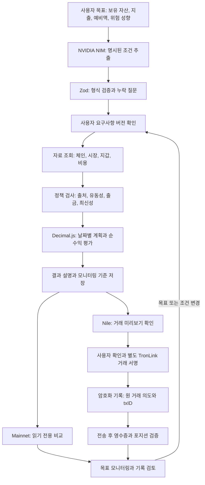

# TROMM

### 지출 일정을 고려하는 TRON 자산 계획 AI 에이전트

[English](README.md) · [시연 안내](docs/DEMO.md) · [구현 상태](docs/IMPLEMENTATION_STATUS.md)

TROMM은 **GWDC 2026 · TRON Challenge B**를 위해 개발한 웹 프로토타입입니다. 보유 자산, 날짜별 지출, 예비액, 위험 성향을 구조화하고, 가능한 계획을 평가한 뒤 저장한 목표의 변화를 관찰합니다.

핵심 질문은 **“예정된 지출에 필요한 돈을 확보하면서 얼마를 운용할 수 있을까?”**입니다. 언어 모델은 조건 추출을 담당하고, 금융 계산과 거래 검증은 명시적인 규칙과 정밀한 수치 연산으로 처리합니다.

**현재 범위:** Mainnet 시장 조사·가정 비교와 별도의 사용자 승인 기반 Nile 테스트넷 거래 흐름입니다. Mainnet 거래 실행은 비활성화되어 있습니다. USDT 시연의 연 5% APY는 설명용 가정이며 실제 상품 수익률이 아닙니다.

## 목차

- [구현 결과와 검증 범위](#구현-결과와-검증-범위)
- [파이프라인](#파이프라인)
- [에이전트 설계](#에이전트-설계)
- [웹 기능](#웹-기능)
- [구조와 기술](#구조와-기술)
- [빠른 시작](#빠른-시작)
- [현재 한계](#현재-한계)
- [팀원](#팀원)
- [문서와 참고 자료](#문서와-참고-자료)

## 구현 결과와 검증 범위

아래 표는 저장소에 포함된 구현과 검증 범위를 설명합니다. 테스트 파일은 자동화 검증 항목을 보여주며, 과거 온체인 거래 성공 여부에는 별도의 거래 증빙이 필요합니다.

| 영역 | 구현된 동작 | 검증 범위 |
| --- | --- | --- |
| 요구사항 분석 | NIM 조건 추출, 형식 검증, 누락 질문, 수정 후 재확인 | 템플릿 대체 경로 포함; 실제 모델 호출에는 키 설정 필요 |
| 지출 기반 계획 | 예정 지출·예비액 보호, 근거가 확보된 경우 날짜별 배분 평가 | 비용·출금 조건·최신 자료가 부족하면 검증된 순수익 판단 보류 |
| Mainnet 조사 | JustLend 시장 조회, 별도의 PSM·Stake 2.0·SUN.io 진단 | 조회 성공만으로 실행 가능한 투자 경로가 입증되지는 않음 |
| 목표 모니터링 | 화면 진입, 5분 주기, 탭 복귀 시 저장된 계획 재평가 | 브라우저 실행 중 유지·신규 예치 보류·재검토 신호 제공 |
| Nile jTRX 거래 | 예치·환매 미리보기, 별도 지갑 서명, 암호화 거래 기록, 영수증·포지션 확인 | 과거 실거래 검증 주장의 원본 증빙 문서는 현재 저장소에 없음 |
| Nile PSM 거래 | 양방향 미리보기, 승인, 잔액·용량·비용 확인, 거래 추적 | 성공한 실제 왕복 거래 증빙은 포함되지 않음 |
| 기록 검토·재현 | 거래 증빙 검토, 내보낸 세션 재현 | 근거가 부족하면 실현 손익 판단 보류; 재현 중 거래 실행 없음 |

소스 위치, 테스트 항목, 구현과 거래 증빙의 구분은 [구현 상태](docs/IMPLEMENTATION_STATUS.md)에 정리했습니다.

## 파이프라인



두 체인의 잔액·금리·거래 증빙은 별도로 관리합니다. 상세 승인·복구 순서는 [운영 안내](docs/OPERATIONS.md)를 참고하세요.

## 에이전트 설계

| 역할 | 구현 방식 |
| --- | --- |
| 요청 이해 | NVIDIA NIM `openai/gpt-oss-20b`로 명시된 사실 추출; 템플릿 파서 대체 경로 제공 |
| 누락 정보 확인 | Zod 입력 검증, 부족한 조건 질문, 수정된 요구사항 재확인 |
| 판단 근거 수집 | 서버 어댑터로 시장·계약·지갑·비용·유동성 조회와 출처 기록 |
| 계획 평가 | 규칙으로 적격성 확인, 근거가 완비된 경우 Decimal.js로 수익·비용 계산 |
| 목표 추적 | 저장된 기준선을 바탕으로 모니터링 신호와 조정 초안 생성 |
| 승인된 거래 지원 | Nile 미리보기, 지갑 소유 확인, 별도 거래 서명, 원 txID 기반 결과 대조 |

에이전트는 **보유 유지**, **재검토**, **자료 부족**을 결과로 제시할 수 있습니다. 모든 요청에서 예치를 추천하도록 만들지 않았습니다.

## 웹 기능

| 경로 | 용도 |
| --- | --- |
| `/` · `/nile` | Nile TRX/jTRX 계획과 별도의 PSM 기술 시험 |
| `/usdt-demo` | 지출 달력, 운용 가능 금액, 설명용 비용 전 이자 |
| `/needs` | 대화와 요구사항 확인 |
| `/plans` | USDT 가정 계산과 별도의 Mainnet 근거 평가 |
| `/markets` | 출처·조회 시각을 포함한 JustLend Mainnet 시장 자료 |
| `/review` | 저장 기록, 모니터링, 세션 재현 |
| `/connections` | 제공 서비스와 네트워크 진단 |

인터페이스는 한국어와 영어를 지원합니다.

## 구조와 기술

| 계층 | 기술 |
| --- | --- |
| 웹 화면 | React, TypeScript, Vite |
| API·에이전트 흐름 | Node.js 24, TypeScript, NVIDIA NIM |
| 검증·계산 | Zod, Decimal.js, 정수 최소 단위 연산 |
| TRON 연동 | TronWeb, TronLink 브라우저 지갑, RPC/REST 어댑터, 선택적 읽기 전용 MCP 연동 |
| 상태·거래 기록 | 브라우저 localStorage; Nile 승인 거래용 암호화 SQLite 기록 |
| 자동화 검증 | Vitest, TypeScript 타입 검사, Vite 빌드 |

```text
src/                 웹 화면과 기능 패널
server/agent/        입력, 조사, 평가, 정책, 승인, 거래 기록
server/data/         시장, 계약, 가격, 비용, 출처 어댑터
server/llm/          NIM 대화 조건 추출
server/mcp/          읽기 전용 MCP 연동
shared/              스키마, 계획, 적격성, 모니터링·재현 모델
tests/               단위·화면·모의 통합 테스트
scripts/             개발 실행, 진단, 스냅샷 내보내기
docs/                설정, 시연, 운영, 구현 상태, 원천 자료
```

## 빠른 시작

**Node.js 24와 npm**을 설치하고 저장소 최상위 폴더에서 실행합니다.

```sh
npm ci
npm run dev
```

macOS에서는 `./scripts/run ci`, `./scripts/run run dev`로 실행하면 설치된 Homebrew Node.js 24를 우선 사용합니다.

[웹 화면](http://127.0.0.1:5173)을 열면 됩니다. API는 [localhost:8787](http://127.0.0.1:8787/api/health)에서 실행됩니다. 실행한 터미널에서 **Ctrl+C**를 누르면 두 개발 프로세스가 종료됩니다.

모델 호출이나 선택적 연동이 필요하면 최상위 폴더에 [.env.example](.env.example)을 복사해 `.env.local`을 만들고 값을 설정한 뒤 재시작하세요. 설명용 계산에는 API 키나 지갑이 필요하지 않습니다. Nile 서명에는 추가로 TronLink, 테스트 자산, 거래 기록 암호화 키가 필요합니다.

설정·검증 명령은 [설정 안내](docs/SETUP.md), 사용 순서는 [시연 안내](docs/DEMO.md)에 정리했습니다. 상세 문서는 영어로 작성했습니다.

## 현재 한계

- Mainnet 거래 실행은 비활성화되어 있습니다. 시장 조사와 가정 계산은 실현 수익의 증거가 아닙니다.
- USDT 시연은 가상의 연 5% APY를 사용하며 비용 전 이자와 검증된 순수익 평가를 구분합니다.
- 현재 일반 유동성 계산은 지출과 보유 자산의 단위가 같아야 합니다. 서로 다른 단위를 처리하려면 검증된 전환 경로가 추가로 필요합니다.
- Stake 2.0·SUN.io는 조사·진단 연동입니다. 이 저장소가 실제 USDT·USDD·스테이킹 3종 최적화를 완성했다는 근거는 없습니다.
- Nile jTRX의 80/20·50/50은 지출·비용 한도를 적용한 예시이며 전역 최적 비율을 입증하지 않습니다.
- 모니터링에는 실행 중인 브라우저가 필요합니다. 무인 거래와 수익 보장은 구현 범위에 포함되지 않습니다.

## 팀원

| 팀원 | 소속 | LinkedIn |
| --- | --- | --- |
| Jeongwoo Kim | Gyeonggi Science Technology University | [프로필](https://www.linkedin.com/in/%EC%A0%95%EC%9A%B0-%EA%B9%80-9a6677355/) |
| Sejun Park | Gyeonggi Science Technology University | [프로필](https://www.linkedin.com/in/sejun-park-32bb0a3a5/) |
| Inwon Baek | Gyeonggi Science Technology University | — |
| Mir Lee | Gyeonggi Science Technology University | [프로필](https://www.linkedin.com/in/mir-lee-890286231/) |

## 문서와 참고 자료

| 문서 | 내용 |
| --- | --- |
| [설정 안내](docs/SETUP.md) | 실행 환경, 설정 변수, 명령, 로컬 문제 해결 |
| [시연 안내](docs/DEMO.md) | 읽기 전용 시연과 선택적 Nile 거래 순서 |
| [운영 안내](docs/OPERATIONS.md) | 승인, 복구, 저장, 개인정보 처리 |
| [구현 상태](docs/IMPLEMENTATION_STATUS.md) | 구현 모듈, 자동화 검증 항목, 미첨부 실거래 증빙 |
| [원천 자료](docs/SOURCES.md) | 제공 서비스 참고 문서와 대응 어댑터 |

TRON·JustLend 개발 생태계와 NVIDIA NIM을 사용해 제작했습니다. 참고 자료: [TRON](https://developers.tron.network/), [JustLend DAO](https://docs.justlend.org/getting_started/overview/), [NVIDIA NIM](https://docs.api.nvidia.com/nim/reference/llm-apis).
